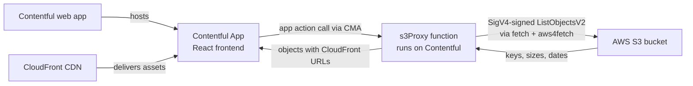

# S3 Contentful App

A Contentful app that lets editors browse an S3 bucket and attach selected files to a
JSON field, with asset URLs served through CloudFront. Listing calls run inside a
Contentful app function, so there is no separate server to deploy or operate.

> **Disclaimer:** This code is provided as-is for use as a reference implementation. It is not officially supported by Contentful. Use at your own discretion and modify as needed for your specific requirements.

## Architecture



### How it works

1. The **Contentful app** (frontend) runs inside the Contentful web app in three
   locations: the configuration screen, a JSON field editor, and a picker dialog.
2. When an editor browses, searches or opens a folder, the frontend calls the `s3Api`
   **app action** through the Content Management API (`sdk.cma.appActionCall`).
3. Contentful runs the **`s3Proxy` function** on its own infrastructure. The function
   reads the AWS credentials from the app's installation parameters, signs a
   ListObjectsV2 request with AWS Signature Version 4 and calls S3 directly.
4. The function returns object keys, sizes, dates and a `displayUrl` built from the
   configured CloudFront domain. The frontend stores the selected objects in the field.
5. Assets themselves are delivered by **CloudFront**; the app never touches object data.

### Why a function instead of a separate proxy server

Earlier versions of this app required a self-hosted Node.js/Express proxy. It existed
for two reasons: the browser must never hold AWS credentials, and S3 does not answer
cross-origin browser requests. A Contentful app function solves both without anything
to host:

- **Nothing to deploy or run.** The function is uploaded with the app bundle
  (`npm run upload`) and executed by Contentful. There is no server, container, DNS name,
  TLS certificate, uptime monitoring or API key for the frontend to hold.
- **Credentials stay server-side.** The AWS secret key is a `Secret`-type installation
  parameter: redacted whenever a user reads it (App SDK or CMA), raw only inside the
  function.
- **Egress is allowlisted.** The manifest restricts the function's outbound traffic to
  `*.amazonaws.com`, and the function only builds request hosts from a validated region.
- **One install.** Everything is configured on the app's configuration screen; the
  separate proxy `.env`, CORS allowlist and shared API key all go away.

### Why aws4fetch

The Contentful Functions sandbox is not a full Node.js runtime: it has no `http` or
`https` modules (verified against the Functions limitations table, 2026-10-27). The AWS
SDK for JavaScript (`@aws-sdk/client-s3`) depends on them through its default Node request
handler, so it cannot run there. What the sandbox does provide is the global `fetch` and
the Web Crypto API. `aws4fetch` is a 16 KB, zero-dependency library that produces AWS
Signature Version 4 requests using exactly those two APIs, which makes it a natural fit:
S3's ListObjectsV2 is a plain signed GET, and the XML it returns is parsed by a small
purpose-built extractor in the function. The result is a function bundle of about 16 KB
with no native or Node-only dependencies.

## Project structure

```
contentful-app/                  Contentful app: frontend, function, deploy scripts
  src/                           React frontend (config screen, field, dialog)
  src/lib/s3Proxy.ts             Frontend side of the app action call
  functions/s3Proxy.ts           The function (see functions/README.md)
  contentful-app-manifest.json   Function id, allowNetworks, action parametersSchema
  scripts/test-proxy.mts         Local harness: runs the handler against live S3
  scripts/set-parameter-definitions.mts  Defines installation parameters (Secret type)
  .env.example                   Variables for the scripts above
```

## Gotchas (read before setup)

- **The field editor and "Test connection" do not work until the bundle is uploaded,
  the app action exists, and the app is installed in the environment.** Only the frontend
  can run locally; the function always runs on Contentful. App action calls are scoped
  to an app installation, so they fail in an environment where the app is not installed.
- **Every listing costs seconds, not milliseconds.** An app action call goes browser to
  CMA to function to S3 and back, and the CMA polls for the result. Expect roughly one to
  several seconds per folder open, page or search. The dialog fetches the folder list and
  the files of the last-visited folder in parallel when it opens, and sub-folders only
  when expanded. Nothing is cached between opens, so new folders appear on the next open.
- **Empty folders show as folders but have no files.** S3 has no real folders; a folder
  created in the S3 console is a zero-byte placeholder object. It appears in the tree,
  and the function hides the placeholder itself from the file list.
- **Run `npm run set-parameter-definitions -- --execute` before installing.** Without
  installation parameter definitions on the app definition, every value (including the
  AWS secret key) is stored as a plain, readable parameter. The definitions make
  `awsSecretAccessKey` a `Secret`. If the app was already installed before the
  definitions existed, re-save its configuration afterwards.
- **Secret re-save behaviour is unverified.** The config screen receives only a redacted
  value for the saved secret and sends that same value back when you save without
  entering a new one, on the assumption that Contentful preserves the stored secret.
  Verify this once per install: save the configuration without touching the secret, then
  click "Test connection". A `SignatureDoesNotMatch` error would mean the secret was
  overwritten; re-enter it.
- **The access key ID, region, bucket and CloudFront domain are readable by anyone with
  access to the space.** Only the secret is hidden. Use a dedicated IAM user whose only
  permission is `s3:ListBucket` on this bucket (policy below).
- Search is a filename filter over up to 10 ListObjectsV2 calls (10,000 keys) under the
  current folder. On a large bucket it can return `hasMore: true` with few results;
  browse into a folder first to narrow it.
- The app must be assigned to a **JSON object** field. It stores an array of asset
  objects (`key`, `name`, `size`, `lastModified`, `eTag`, `isImage`, `displayUrl`).
- `npm run build` runs `tsc` first, so type errors fail the build. The function has its
  own tsconfig; `npm run typecheck` checks both trees.

## Setup from scratch

Prerequisites: a Contentful organization you can create apps in, an AWS account with the
bucket and a CloudFront distribution in front of it, Node.js 22.18 or newer (the scripts
use built-in TypeScript type stripping), and npm.

### 1. AWS: IAM user and CloudFront

Create an IAM user for the app with this policy, then create an access key for it
(IAM > Users > Security credentials > Create access key > Application running outside
AWS):

```json
{
  "Version": "2012-10-17",
  "Statement": [
    {
      "Effect": "Allow",
      "Action": ["s3:ListBucket"],
      "Resource": ["arn:aws:s3:::YOUR-BUCKET-NAME"]
    }
  ]
}
```

Only `s3:ListBucket` is needed: the function lists keys; it never reads object bodies.

CloudFront is what actually delivers the files, and it lets the bucket stay private:

1. CloudFront > Create distribution. Origin domain: your S3 bucket. Origin access: Origin
   Access Control (create a control setting if needed).
2. Default cache behaviour: Viewer protocol policy "Redirect HTTP to HTTPS", allowed
   methods GET and HEAD, cache policy CachingOptimized.
3. After creation, copy the bucket policy CloudFront shows and apply it to the bucket
   (Permissions > Bucket policy). Direct S3 access can then be denied entirely.
4. Note the distribution domain name, e.g. `d1234abcd.cloudfront.net`.

### 2. Create the app definition

In the Contentful web app open your organization settings > Apps > Create app, and set:

- Frontend URL: leave empty if you will host the frontend on Contentful with
  `npm run upload`, or `http://localhost:3000` while developing.
- Locations: App configuration screen, Entry field (check only JSON object), Dialog.

Or run `npm run create-app-definition` from `contentful-app/` for the same prompts.

### 3. Environment file for the scripts

Create `contentful-app/.env` from `.env.example`. It is used by the deploy scripts and the
local function tester only, never by the app at runtime:

```env
CONTENTFUL_ORG_ID=your-organization-id
CONTENTFUL_APP_DEF_ID=your-app-definition-id
CONTENTFUL_ACCESS_TOKEN=your-cma-personal-access-token

# only for npm run test:proxy
AWS_REGION=us-east-1
AWS_ACCESS_KEY_ID=
AWS_SECRET_ACCESS_KEY=
S3_BUCKET_NAME=
CLOUDFRONT_DOMAIN=d1234abcd.cloudfront.net
```

The scripts read this file and the process environment only. There is no fallback to the
Contentful CLI's cached login or to AWS CLI profiles; a missing variable is an error that
names it.

### 4. Define installation parameters, build, upload, create the action

```bash
cd contentful-app
npm install
npm run set-parameter-definitions            # dry run: shows current and proposed
npm run set-parameter-definitions -- --execute
npm run build
npm run upload
npm run upsert-actions
```

- `set-parameter-definitions` writes the installation parameter definitions to the app
  definition (this is what makes the secret key a `Secret`).
- `build` type-checks, builds the frontend into `build/` and the function into
  `build/functions/s3Proxy.js`.
- `upload` uploads `build/` as an app bundle (frontend plus function) and activates it.
  Both `upload` and `upsert-actions` go through `scripts/run-app-scripts.mts`, which
  loads `.env` and passes the values as explicit `--ci` flags. You do not need to export
  anything in your shell, and the CLI's interactive browser login (which would cache a
  token into `.env` by itself) is never used.
- `upsert-actions` creates or updates the `s3Api` app action from
  `contentful-app-manifest.json`. The frontend calls the function only through this
  action, so this step is not optional.

### 5. Install and configure

1. Install the app into the space and environment. The configuration screen asks for
   the AWS region, access key ID, secret access key, bucket name, CloudFront domain and
   the per-field maximum. Save.
2. Click "Test connection". It calls the deployed function with the saved values and
   reports the bucket and region, or a specific error (wrong region, bad credentials,
   missing bucket, not installed).
3. In the content model, add a JSON object field and select this app on its Appearance
   tab.

## Local development

```bash
cd contentful-app
npm run dev
```

Serves the frontend on http://localhost:3000; set that as the app definition's frontend
URL while developing. The function still runs on Contentful, so listing from a local
frontend requires the uploaded bundle, the app action and an installation (steps 4 and 5).

## Testing the function locally (isolated harness)

`scripts/test-proxy.mts` imports the real `handler` from `functions/s3Proxy.ts` and calls
it on your machine with a synthetic event and context, hitting live S3. No bundle upload,
no installation, no CMA round trip.

Caveats first:

- This is not an end-to-end test. It bypasses the action's `parametersSchema`
  validation, the sandbox's `allowNetworks` restriction and real installation parameters.
  A run that passes here can still fail in Contentful if the manifest or action wiring is
  wrong; use "Testing the deployed function" below for that.
- Credentials come from `AWS_REGION`, `AWS_ACCESS_KEY_ID`, `AWS_SECRET_ACCESS_KEY`,
  `S3_BUCKET_NAME` and `CLOUDFRONT_DOMAIN`, from the environment or `contentful-app/.env`.
  All five are required; the script exits naming any that are missing.
- The script exits 2 on any `ok: false` result so it can be used from other tooling.

```bash
cd contentful-app
npm run test:proxy -- testConnection
npm run test:proxy -- listPrefixes
npm run test:proxy -- listPrefixes images/
npm run test:proxy -- listObjects images/ 10
npm run test:proxy -- listObjects images/ 10 <nextContinuationToken>
npm run test:proxy -- search logo images/ 25
```

The output is the handler's own log lines (request URL, HTTP status and timing per S3
call) followed by the JSON the frontend would receive. Error paths are testable too, for
example `AWS_REGION=eu-west-1 npm run test:proxy -- testConnection` for the wrong-region
message, or `AWS_SECRET_ACCESS_KEY=wrong ...` for the 403 message.

## Testing the deployed function

App action calls are scoped to an installation, so this only works after step 5. Set
`SPACE_ID` and `ENVIRONMENT_ID` to where the app is installed; the call uses that
installation's saved credentials.

```bash
cd contentful-app
set -a; source .env; set +a
SPACE_ID=your-space-id
ENVIRONMENT_ID=master
curl -s -X POST \
  "https://api.contentful.com/spaces/$SPACE_ID/environments/$ENVIRONMENT_ID/app_installations/$CONTENTFUL_APP_DEF_ID/actions/s3Api/calls" \
  -H "Authorization: Bearer $CONTENTFUL_ACCESS_TOKEN" \
  -H "Content-Type: application/vnd.contentful.management.v1+json" \
  -d '{"parameters":{"action":"testConnection"}}'
```

The call is asynchronous. Take `sys.id` from the response and poll:

```bash
curl -s "https://api.contentful.com/spaces/$SPACE_ID/environments/$ENVIRONMENT_ID/actions/s3Api/calls/CALL_ID_HERE" \
  -H "Authorization: Bearer $CONTENTFUL_ACCESS_TOKEN"
```

`response.body` holds the function's JSON, e.g. `{"ok":true,"bucket":"...","region":"us-east-1"}`.
Function logs are in the web app under organization settings > Apps > this app >
Functions > s3Proxy.

## The s3Api action

Parameters (validated by Contentful against the manifest's `parametersSchema`):

| Parameter           | Type    | Used by                 | Rules                                   |
| ------------------- | ------- | ----------------------- | --------------------------------------- |
| `action`            | string  | all                     | `listPrefixes`, `listObjects`, `search`, `testConnection` |
| `prefix`            | string  | listPrefixes, listObjects, search | max 500 chars, no `..`; trailing `/` added |
| `pageSize`          | integer | listObjects, search     | 1 to 200, default 25                    |
| `continuationToken` | string  | listObjects             | `nextContinuationToken` from a previous page |
| `q`                 | string  | search                  | required, 1 to 200 chars, case-insensitive filename substring |

Results are `{ ok: true, ... }` or `{ ok: false, error, status? }`. The handler never
throws; a rejected action call means the function or action is not deployed or the app is
not installed. See `contentful-app/functions/README.md` for the dispatch and error table.

## Troubleshooting

- **`upload` or `upsert-actions` fails with 401 and the request shows `Bearer ... true`**:
  the CLI received an empty token. This happens when `contentful-app-scripts` is run by
  hand with `$CONTENTFUL_ACCESS_TOKEN` in a shell that has not loaded `.env`. Use the npm
  scripts, which load `.env` themselves.
- **"Could not invoke the S3 proxy function"**: the app is not installed in this
  environment, the bundle has not been uploaded, or `npm run upsert-actions` has not been
  run.
- **"App is not configured: missing ..."**: save the configuration screen with every
  value filled in.
- **"Bucket ... is not in region ..."**: S3 answered with a redirect; fix the region.
- **"S3 rejected the request (SignatureDoesNotMatch / InvalidAccessKeyId)"**: wrong key
  or secret. If this appears right after re-saving the configuration without changing
  the secret, see the Secret re-save gotcha above.
- **"S3 rejected the request (AccessDenied)"**: the IAM user lacks `s3:ListBucket` on
  the bucket.
- **Thumbnails do not load**: the CloudFront domain is wrong or the distribution does not
  have access to the bucket. Open a `displayUrl` from the field directly to check.

## License

MIT
