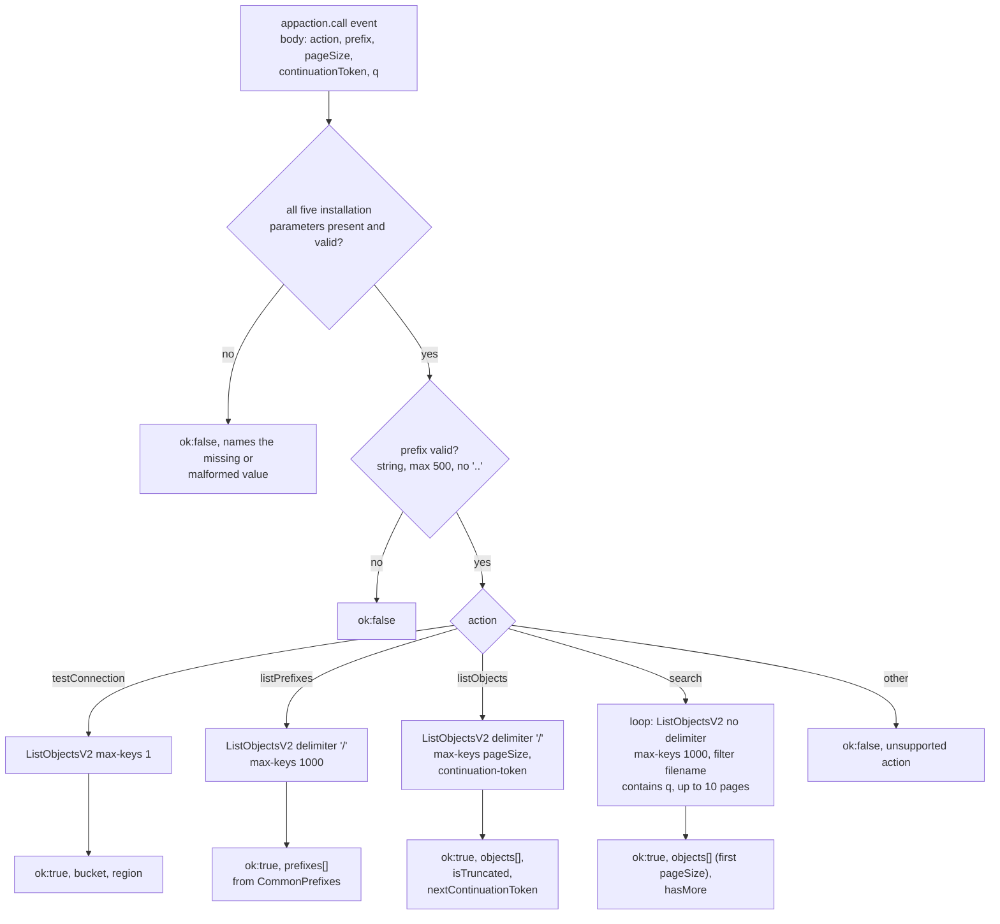

# s3Proxy function internals

This documents the logic inside `s3Proxy.ts`, the app-action function that performs
the browser's S3 listing calls. For the outer picture (why the listing runs in a
function, how the bundle is deployed, how to test) see the project README.

## Runtime constraints that shaped the code

- The function runs in Contentful's Functions sandbox, not full Node.js. Node's
  `http`/`https` modules do not exist there, so `@aws-sdk/client-s3` (whose default
  request handler is built on them) cannot be used. The sandbox does provide the global
  `fetch` and the Web Crypto API, which is exactly what `aws4fetch` needs to produce
  AWS Signature Version 4 requests. That is the whole reason for the dependency: it is
  a 16 KB, zero-dependency signer, and S3's ListObjectsV2 is a plain signed GET.
- ListObjectsV2 answers in XML. There is no DOM parser in the sandbox, and the schema
  is small and fixed, so the file carries a purpose-built extractor (`xmlText`,
  `xmlBlocks`, `unescapeXml`) rather than an XML library.
- Outbound traffic is restricted twice: Contentful enforces the manifest's
  `allowNetworks` (`*.amazonaws.com`), and the code only ever builds the request host
  from a region that matched `REGION_RE`. The region and bucket are editor-visible
  installation parameters; without the regex checks a tampered value could redirect a
  signed request (which carries the access key ID) elsewhere under `amazonaws.com`.
- The path-style endpoint (`s3.<region>.amazonaws.com/<bucket>`) is used on purpose: the
  host then depends only on the validated region, and bucket names containing dots work
  over TLS, which virtual-hosted style cannot guarantee.
- Credentials arrive via `context.appInstallationParameters`. `awsSecretAccessKey` is a
  Secret-type parameter, so the raw value exists only here; the browser gets a redacted
  value. Nothing here logs headers, and the signed URL contains no credentials.

## Handler dispatch

Every S3 call goes through `listObjectsV2`, whose error ladder is:

| Response                        | Result                                                              |
| ------------------------------- | ------------------------------------------------------------------- |
| fetch throws                    | `ok:false` "Could not reach S3 in region ..."                       |
| 301 / `PermanentRedirect`       | `ok:false` bucket is not in the configured region (status 301)      |
| 403 (any code)                  | `ok:false` credentials or missing `s3:ListBucket` (status 403)      |
| 404 / `NoSuchBucket`            | `ok:false` bucket not found (status 404)                            |
| other non-2xx                   | `ok:false` with the HTTP status and S3 error code                   |
| 2xx                             | `ok:true` with parsed `Contents`, `CommonPrefixes`, truncation info |

## Return shape

Objects pass through one mapper and come out as the `S3Asset` shape the frontend stores
verbatim in the JSON field: `key`, `name`, `size`, `lastModified`, `eTag`, `isImage`,
`displayUrl`. `displayUrl` is `https://<cloudfrontDomain>/<key>` with each path segment
URL-encoded, so keys with spaces or `#`, `?`, `+` resolve.

All paths return `{ ok: true, ... }` or `{ ok: false, error, status? }`. The union is
mirrored in `src/lib/s3Proxy.ts` as a deliberate copy: the `functions/` tree builds
independently, so sharing a module would couple the two builds. Contentful serializes the
returned object into the app action call's `response.body`, where the frontend parses it.

## Logging

Every invocation logs `request parameters`, one `s3 request: GET <url>` and
`s3 response: HTTP <status> in <ms>` pair per S3 call, and `function result (<ms>)`.
Logs are visible in the web app under organization settings > Apps > this app >
Functions > s3Proxy. Payloads are truncated at 2000 characters. The signed URL contains
no credentials (they travel in the `Authorization` header, which is never logged).
